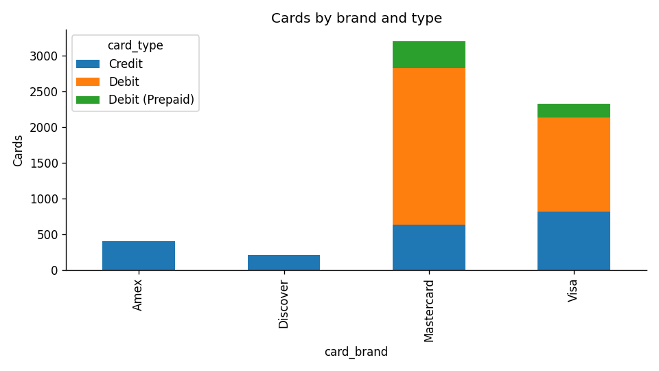
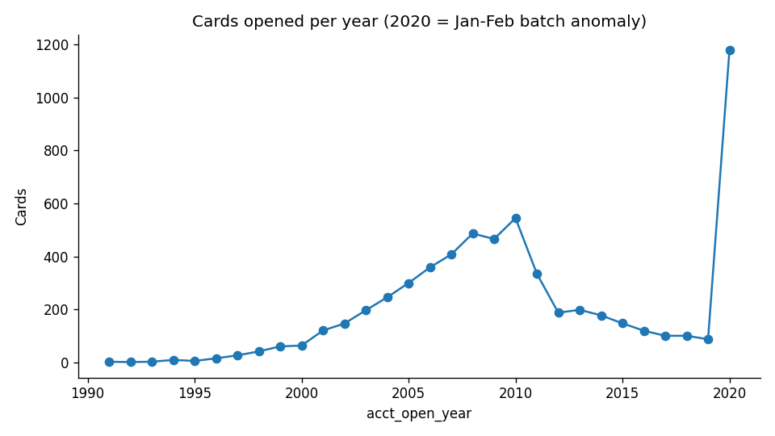
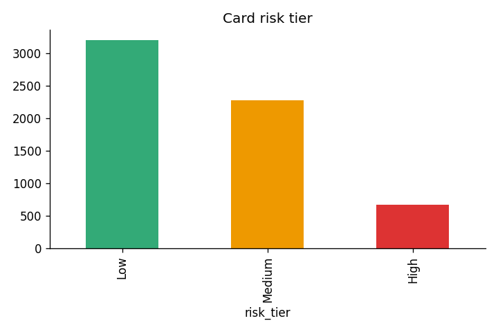
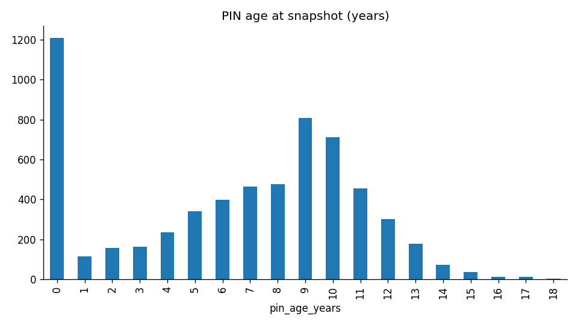
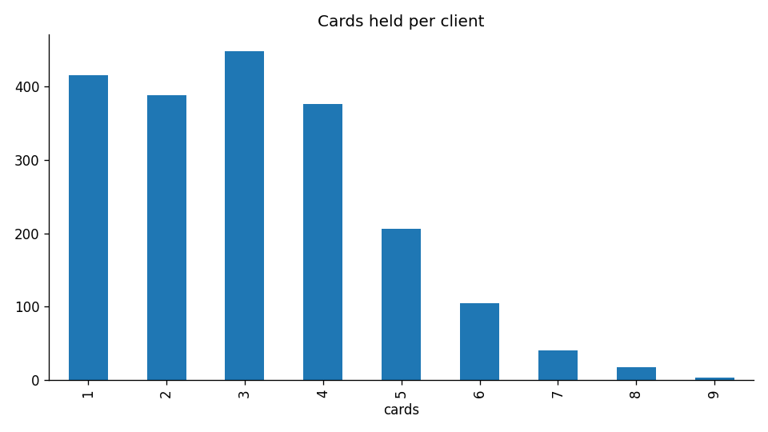

# Card Portfolio Analysis — Python · SQL · Power BI

    

End-to-end analysis of a 6,146-card portfolio held by 2,000 clients: data cleaning and feature engineering in **Python**, a star-schema warehouse and business queries in **SQL**, and an interactive **Power BI** dashboard.

> **TL;DR** — Found a **2,601-card reissue pipeline** (42% of the portfolio, ~$37M of limit), 668 high-risk cards, and a data-quality artifact that was **understating security risk by ~7 points**.



## Business questions
1. What does the portfolio look like by brand, card type and credit limit?
2. How secure is it — chip adoption, PIN hygiene, exposure?
3. How many cards need reissuing soon?
4. How concentrated is the client base, and who are the highest-value / highest-risk clients?
5. Can the data be trusted? What quality issues exist?

## Dataset
`cards_data.csv` — 6,146 rows × 13 columns: card id, client id, brand, type, card number, expiry, CVV, chip flag, cards issued, credit limit, account-open month, year PIN last changed, dark-web flag. No nulls, no duplicate rows, unique card ids.

**Snapshot date:** 2020-02-29 (the latest account-open month in the data). All "expired" and "age" figures are measured against it.

**Privacy:** full card numbers and CVVs are dropped in the first cleaning step; only the last 4 digits are kept. Nothing downstream (SQL, Power BI) ever sees them.

## Project structure
```
data/raw/cards_data.csv            original file
data/processed/cards_clean.csv     cleaned + engineered (25 columns)
data/processed/clients_summary.csv one row per client
data/cards.db                      SQLite warehouse
python/01_clean_and_analyze.py     cleaning, features, EDA, charts
python/02_load_to_sql.py           builds the DB and runs all SQL
sql/01_schema.sql                  star schema (dim_client, fact_cards)
sql/02_analysis.sql                11 business queries (CTEs, window functions)
powerbi/01_power_query.m           Power Query load scripts
powerbi/02_dax_measures.dax        25+ DAX measures + date table
powerbi/03_theme.json              report theme
powerbi/04_dashboard_build_guide.md  page-by-page build steps
python/03_dashboard_exports.py     pre-aggregated, filter-ready tables for the web dashboard
reports/dashboard_data/            dashboard tables (every brand x type x batch-filter view)
reports/figures/                   Python charts
reports/sql_results/               every query result as CSV
```

## How to run
The raw file contains full (synthetic) card numbers and CVVs, so it is **not committed** to this repo. Download `cards_data.csv` from the public *Financial Transactions Dataset* on Kaggle and place it in `data/raw/` (see `data/raw/README.md`). The masked, cleaned output (`data/processed/cards_clean.csv`) is included so you can explore results without running anything.

```bash
pip install -r requirements.txt
python python/01_clean_and_analyze.py
python python/02_load_to_sql.py
python python/03_dashboard_exports.py
```
Then follow `powerbi/04_dashboard_build_guide.md`.

## Cleaning and feature engineering
| Step | Detail |
|---|---|
| Type fixes | `credit_limit` "$24295" → 24295.0; `expires` / `acct_open_date` "MM/YYYY" → dates; YES/No → booleans |
| Masking | `card_number` → `card_last4`; `cvv` dropped |
| Validation | asserted expiry > open date, PIN change ≥ open year, limits ≥ 0 (all pass) |
| New features | `account_age_years`, `pin_age_years`, `expiry_status` (Expired / Expiring within 12 mo / Active), `limit_band`, `card_life_months` |
| Risk model | 1 point each for: no chip, PIN unchanged 10+ years, expired → `risk_score` 0–3 → tier Low / Medium / High |
| DQ flags | `dq_2020_batch`, `dq_short_life` (kept as flags so the dashboard can filter them) |

## Key findings

**Portfolio**
- 6,146 cards, 2,000 clients, 3.07 cards per client; total limits of **$88.2M**.
- Mastercard dominates (52% of cards), then Visa (38%), Amex (7%), Discover (3%). Amex and Discover issue credit cards only.
- Debit is the largest type (57%) and carries the most limit: Mastercard Debit alone is 36% of cards and $40.1M of limit.
- Average limit: Debit $18,558, Credit $11,174, Prepaid $64 — prepaid cards are effectively a separate product and should be excluded from limit averages.

**Security**
- Chip adoption is **89.5%** — 646 cards still have no chip, spread evenly across brands (89–91%).
- **29%** of cards have a PIN unchanged for 10+ years.
- 668 cards (10.9%) are **High risk** (2+ flags). Risk is almost identical across brands and card types, which suggests a portfolio-wide policy gap rather than one product's problem.
- 94 clients hold 2+ high-risk cards — a ready-made outreach list (SQL Q09).
- No cards are flagged on the dark web.

**Lifecycle**
- At snapshot, 1,244 cards (20%) were already expired and 1,357 more expire within 12 months — a **2,601-card reissue pipeline** (42% of the portfolio) representing about $37M of limit.

**Clients**
- 21% of clients hold one card; 19% hold 5+. The top 10 clients each hold $250K–$393K of combined limit.
- Account age has essentially no relationship with credit limit (correlation −0.02): 0–5 year accounts average $16.0K, 20+ year accounts $15.0K.

**Data quality**
- **1,178 cards (19%) were opened in Jan–Feb 2020**, versus ~112 per year in 2015–2019. This is almost certainly a migration or bulk-reissue artifact, not real growth; every 2020 card also has a PIN age of 0. Trend charts should filter it out or label it.
- **The anomaly hides risk.** Excluding the batch, the stale-PIN rate rises from 29.0% to 35.9% and the high-risk rate from 10.9% to 13.2%, because every batch card has a brand-new PIN. Reporting on the raw data understates the security problem.
- 677 cards are valid for under 12 months after opening (466 of them in the 2020 batch).
- 31 cards have a $0 limit (26 of them credit cards).
- 3,508 debit cards carry a "credit_limit" — likely an overdraft/spend limit; the column name is misleading and should be documented.

## Visuals
| Account openings (2020 batch anomaly) | Risk tiers |
|---|---|
|  |  |
| **PIN age** | **Cards per client** |
|  |  |

## Recommendations
1. Prioritize chip replacement for the 646 no-chip cards, starting with the ones also flagged for stale PINs.
2. Prompt PIN changes for the 29% of cards unchanged in 10+ years.
3. Plan reissue capacity for ~2,600 cards and contact the 94 clients with multiple high-risk cards first.
4. Confirm the source of the Jan–Feb 2020 batch with data owners before using it in growth reporting.
5. Rename or document `credit_limit` for debit and prepaid products.

## Skills demonstrated
Python (pandas, matplotlib, data validation, feature engineering) · SQL (schema design, indexes, CTEs, window functions — `RANK`, `LAG`, running totals, `UNION ALL` audits) · Power BI (Power Query M, star-schema modelling, DAX with `CALCULATE`, `USERELATIONSHIP`, `RANKX`, themes, drill-through) · data privacy (PAN/CVV masking) · data-quality auditing.

## Author
**Shubham Navik** — aspiring Data / BI Analyst, Ottawa, ON · [GitHub](https://github.com/shubhm21)
